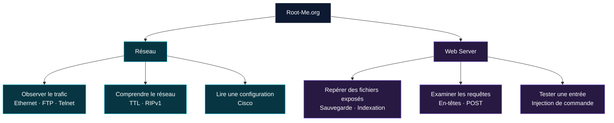

  

  <picture>
    <source media="(prefers-color-scheme: dark)" srcset="assets/root-me-mark-white.svg">
    <source media="(prefers-color-scheme: light)" srcset="assets/root-me-mark-black.svg">
    
  </picture>

<h1 align="center">Root-Me.org</h1>

  <strong>Mes write-ups, classés par domaine.</strong> 
  Des captures, une démarche et un résultat pour chaque challenge documenté.

  
  
  

---

## Parcours des notions

Chaque branche regroupe les techniques rencontrées dans les write-ups. Les fiches plus bas donnent accès au challenge et à son archive.

## 🌐 Réseau

[Ouvrir le dossier Network](Network/)

> **CISCO**
> Décoder les valeurs d'une configuration Cisco.
> [Challenge Root-Me](https://www.root-me.org/fr/Challenges/Reseau/CISCO-mot-de-passe) · [Write-up chiffré](Network/CARON_WU_CISCO.zip)

> **ETHERNET - trame**
> Reconstituer une requête HTTP à partir d'une trame hexadécimale.
> [Challenge Root-Me](https://www.root-me.org/fr/Challenges/Reseau/ETHERNET-trame) · [Write-up chiffré](Network/CARON_WU_ETHERNET_TRAME.zip)

> **FTP - Authentification**
> Lire un échange FTP dans Wireshark et repérer l'authentification.
> [Challenge Root-Me](https://www.root-me.org/fr/Challenges/Reseau/FTP-Authentification) · [Write-up chiffré](Network/CARON_WU_FTP_AUTHENTIFICATION.zip)

> **IP - Time To Live**
> Distinguer le TTL des requêtes ICMP de celui des réponses.
> [Challenge Root-Me](https://www.root-me.org/fr/Challenges/Reseau/IP-Time-To-Live) · [Write-up chiffré](Network/CARON_WU_IP_TIME_TO_LIVE.zip)

> **RIPv1 - no authentication**
> Comprendre les annonces RIP et tester leur absence d'authentification.
> [Challenge Root-Me](https://www.root-me.org/fr/Challenges/Reseau/RIPv1-no-authentication) · [Write-up chiffré](Network/CARON_WU_RIPV1_NO_AUTHENTICATION.zip)

> **TELNET - authentification**
> Reconstituer une connexion Telnet à partir des paquets capturés.
> [Challenge Root-Me](https://www.root-me.org/fr/Challenges/Reseau/TELNET-authentification) · [Write-up chiffré](Network/CARON_WU_TELNET_AUTHENTIFICATION.zip)

## 🧩 Web Server

[Ouvrir le dossier Web Server](Web%20Server/)

> **Fichier de sauvegarde**
> Repérer un fichier de sauvegarde qui expose du code PHP.
> [Challenge Root-Me](https://www.root-me.org/fr/Challenges/Web-Serveur/Fichier-de-sauvegarde) · [Write-up chiffré](Web%20Server/CARON_WU_WEB_SERVER_FICHIER_DE_SAUVEGARDE.zip)

> **HTTP - Directory indexing**
> Explorer des répertoires dont l'index reste accessible.
> [Challenge Root-Me](https://www.root-me.org/en/Challenges/Web-Server/HTTP-Directory-indexing) · [Write-up chiffré](Web%20Server/CARON_WU_WEB_SERVER_HTTP_DIRECTORY_INDEXING.zip)

> **HTTP - Headers**
> Interpréter un en-tête HTTP inhabituel dans Burp.
> [Challenge Root-Me](https://www.root-me.org/fr/Challenges/Web-Serveur/HTTP-Headers) · [Write-up chiffré](Web%20Server/CARON_WU_WEB_SERVER_HTTP_HEADERS.zip)

> **HTTP - POST**
> Intercepter un formulaire POST et modifier la valeur envoyée.
> [Challenge Root-Me](https://www.root-me.org/en/Challenges/Web-Server/HTTP-POST) · [Write-up chiffré](Web%20Server/CARON_WU_WEB_SERVER_HTTP_POST.zip)

> **PHP - Injection de commande**
> Tester une injection de commande dans un formulaire de ping.
> [Challenge Root-Me](https://www.root-me.org/fr/Challenges/Web-Serveur/Injection-de-commande) · [Write-up chiffré](Web%20Server/CARON_WU_WEB_SERVER_PHP_INJECTION_DE_COMMANDE.zip)

---

Les solutions et les captures sont réunies dans des archives ZIP chiffrées. Le mot de passe est communiqué séparément. Le [suivi des challenges](../caron.md) regroupe Root-Me PRO et Root-Me.org.
