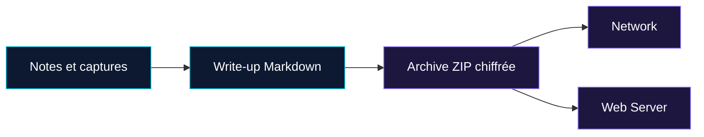

  

  <picture>
    <source media="(prefers-color-scheme: dark)" srcset="assets/root-me-mark-white.svg">
    <source media="(prefers-color-scheme: light)" srcset="assets/root-me-mark-black.svg">
    
  </picture>

<h1 align="center">Root-Me.org</h1>

  <strong>Mes write-ups, classés par domaine.</strong> 
  Des captures, une démarche et un résultat pour chaque challenge documenté.

  
  
  

---

## Explorer

| Domaine | Ce que l'on y trouve | Dossier |
| :--- | :--- | :--- |
| 🌐 **Réseau** | Analyse de captures, protocoles et configuration réseau | [Ouvrir Network](https://github.com/alex-beze/Module_Intro_Securite_2026-2027/tree/main/CARON/Root-Me.org/Network) |
| 🧩 **Web Server** | Requêtes HTTP, fichiers exposés et injection de commande | [Ouvrir Web Server](https://github.com/alex-beze/Module_Intro_Securite_2026-2027/tree/main/CARON/Root-Me.org/Web%20Server) |

<strong>🌐 Voir les 6 write-ups Réseau</strong>

| Challenge | Archive |
| :--- | :--- |
| [CISCO](https://www.root-me.org/fr/Challenges/Reseau/CISCO-mot-de-passe) | [Télécharger](Network/CARON_WU_CISCO.zip) |
| [ETHERNET - trame](https://www.root-me.org/fr/Challenges/Reseau/ETHERNET-trame) | [Télécharger](Network/CARON_WU_ETHERNET_TRAME.zip) |
| [FTP - Authentification](https://www.root-me.org/fr/Challenges/Reseau/FTP-Authentification) | [Télécharger](Network/CARON_WU_FTP_AUTHENTIFICATION.zip) |
| [IP - Time To Live](https://www.root-me.org/fr/Challenges/Reseau/IP-Time-To-Live) | [Télécharger](Network/CARON_WU_IP_TIME_TO_LIVE.zip) |
| [RIPv1 - no authentication](https://www.root-me.org/fr/Challenges/Reseau/RIPv1-no-authentication) | [Télécharger](Network/CARON_WU_RIPV1_NO_AUTHENTICATION.zip) |
| [TELNET - authentification](https://www.root-me.org/fr/Challenges/Reseau/TELNET-authentification) | [Télécharger](Network/CARON_WU_TELNET_AUTHENTIFICATION.zip) |

<strong>🧩 Voir les 5 write-ups Web Server</strong>

| Challenge | Archive |
| :--- | :--- |
| [Fichier de sauvegarde](https://www.root-me.org/fr/Challenges/Web-Serveur/Fichier-de-sauvegarde) | [Télécharger](Web%20Server/CARON_WU_WEB_SERVER_FICHIER_DE_SAUVEGARDE.zip) |
| [HTTP - Directory indexing](https://www.root-me.org/en/Challenges/Web-Server/HTTP-Directory-indexing) | [Télécharger](Web%20Server/CARON_WU_WEB_SERVER_HTTP_DIRECTORY_INDEXING.zip) |
| [HTTP - Headers](https://www.root-me.org/fr/Challenges/Web-Serveur/HTTP-Headers) | [Télécharger](Web%20Server/CARON_WU_WEB_SERVER_HTTP_HEADERS.zip) |
| [HTTP - POST](https://www.root-me.org/en/Challenges/Web-Server/HTTP-POST) | [Télécharger](Web%20Server/CARON_WU_WEB_SERVER_HTTP_POST.zip) |
| [PHP - Injection de commande](https://www.root-me.org/fr/Challenges/Web-Serveur/Injection-de-commande) | [Télécharger](Web%20Server/CARON_WU_WEB_SERVER_PHP_INJECTION_DE_COMMANDE.zip) |

---

Les solutions et les captures sont réunies dans des archives ZIP chiffrées. Le mot de passe est communiqué séparément. Le [suivi des challenges](../caron.md) regroupe Root-Me PRO et Root-Me.org.
