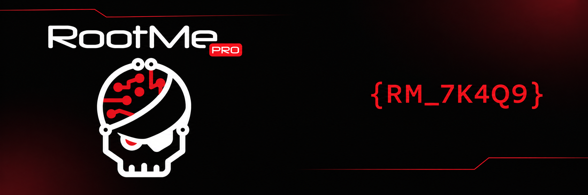
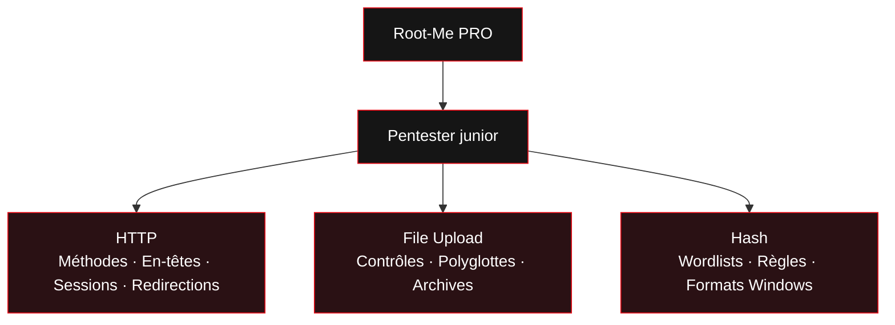

  

<h1 align="center">Root-Me PRO</h1>

  <strong>Mes write-ups, classés par parcours et par module.</strong> 
  Une démarche documentée pour chaque challenge publié.

  
  
  
  

---

## Parcours des notions

Les archives publiées couvrent actuellement le parcours **Pentester junior**. Le dossier Root-Me PRO pourra accueillir d'autres parcours par la suite.

## Pentester junior

[Ouvrir le dossier Pentester junior](Pentester%20junior/)

<strong>🌐 HTTP : 12 write-ups</strong>

> **HTTP - Be methodic**
> Tester les méthodes HTTP et lire l'en-tête `Allow`.
> [Write-up chiffré](Pentester%20junior/HTTP/CARON_WU_HTTP_BE_METHODIC.zip)

> **HTTP - Cookies**
> Observer l'effet d'un cookie sur la réponse du serveur.
> [Write-up chiffré](Pentester%20junior/HTTP/CARON_WU_HTTP_COOKIES.zip)

> **HTTP - Directory indexing**
> Parcourir une arborescence dont l'index reste accessible.
> [Write-up chiffré](Pentester%20junior/HTTP/CARON_WU_HTTP_DIRECTORY_INDEXING.zip)

> **HTTP - Headers**
> Modifier un en-tête de requête pour tester un contrôle d'accès.
> [Write-up chiffré](Pentester%20junior/HTTP/CARON_WU_HTTP_HEADERS.zip)

> **HTTP - Head cracker**
> Repérer une information exposée dans les en-têtes de réponse.
> [Write-up chiffré](Pentester%20junior/HTTP/CARON_WU_HTTP_HEAD_CRACKER.zip)

> **HTTP - Open-redirect**
> Analyser une redirection et ses paramètres de destination.
> [Write-up chiffré](Pentester%20junior/HTTP/CARON_WU_HTTP_OPEN_REDIRECT.zip)

> **HTTP - PentaRules**
> Combiner plusieurs contraintes HTTP dans une seule requête.
> [Write-up chiffré](Pentester%20junior/HTTP/CARON_WU_HTTP_PENTARULES.zip)

> **HTTP - POST**
> Modifier un champ caché dans le corps d'un formulaire POST.
> [Write-up chiffré](Pentester%20junior/HTTP/CARON_WU_HTTP_POST.zip)

> **HTTP - Premiers pas**
> Répartir des valeurs entre un en-tête et le corps d'une requête.
> [Write-up chiffré](Pentester%20junior/HTTP/CARON_WU_HTTP_PREMIERS_PAS.zip)

> **HTTP - Redirection**
> Lire le corps d'une réponse avant de suivre sa redirection.
> [Write-up chiffré](Pentester%20junior/HTTP/CARON_WU_HTTP_REDIRECTION.zip)

> **HTTP - Restriction IP**
> Tester un contrôle d'accès basé sur l'adresse IP déclarée.
> [Write-up chiffré](Pentester%20junior/HTTP/CARON_WU_HTTP_RESTRICTION_IP.zip)

> **HTTP - User-agent**
> Comprendre pourquoi un User-Agent ne prouve pas l'identité.
> [Write-up chiffré](Pentester%20junior/HTTP/CARON_WU_HTTP_USER_AGENT.zip)

<strong>📁 File Upload : 6 write-ups</strong>

> **File Upload - Double extensions**
> Tester le contrôle d'extension d'un fichier envoyé.
> [Write-up chiffré](Pentester%20junior/File%20Upload/CARON_WU_FILE_UPLOAD_DOUBLE_EXTENSIONS.zip)

> **File Upload - Introduction**
> Observer l'upload, les redirections et les fichiers partagés.
> [Write-up chiffré](Pentester%20junior/File%20Upload/CARON_WU_FILE_UPLOAD_INTRODUCTION.zip)

> **File Upload - Null bytes**
> Examiner le traitement du nom de fichier lors d'un upload.
> [Write-up chiffré](Pentester%20junior/File%20Upload/CARON_WU_FILE_UPLOAD_NULL_BYTES.zip)

> **File Upload - Polyglot**
> Étudier les contrôles JPEG et l'utilisation d'un fichier polyglotte.
> [Write-up chiffré](Pentester%20junior/File%20Upload/CARON_WU_FILE_UPLOAD_POLYGLOT.zip)

> **File Upload - Type MIME**
> Modifier le type MIME déclaré lors d'un upload.
> [Write-up chiffré](Pentester%20junior/File%20Upload/CARON_WU_FILE_UPLOAD_TYPE_MIME.zip)

> **File Upload - ZIP**
> Tester l'extraction d'une archive contenant un lien symbolique.
> [Write-up chiffré](Pentester%20junior/File%20Upload/CARON_WU_FILE_UPLOAD_ZIP.zip)

<strong>🔐 Hash : 10 write-ups</strong>

> **Hash - DCC**
> Identifier une empreinte DCC et son format avec nom d'utilisateur.
> [Write-up chiffré](Pentester%20junior/Hash/CARON_WU_HASH_DCC.zip)

> **Hash - DCC2**
> Tester une empreinte DCC2 avec une liste de mots.
> [Write-up chiffré](Pentester%20junior/Hash/CARON_WU_HASH_DCC2.zip)

> **Hash - LM**
> Extraire une empreinte LM d'un dump et la tester avec Hashcat.
> [Write-up chiffré](Pentester%20junior/Hash/CARON_WU_HASH_LM.zip)

> **Hash - NT**
> Retrouver un mot de passe à partir d'une empreinte NT.
> [Write-up chiffré](Pentester%20junior/Hash/CARON_WU_HASH_NT.zip)

> **Hash - NTLMv1**
> Tester une capture NTLMv1 issue de Responder.
> [Write-up chiffré](Pentester%20junior/Hash/CARON_WU_HASH_NTLMV1.zip)

> **Hash - NTLMv1 - Custom**
> Construire des candidats à partir des indices du scénario.
> [Write-up chiffré](Pentester%20junior/Hash/CARON_WU_HASH_NTLMV1_CUSTOM.zip)

> **Hash - NTLMv2**
> Tester une capture NTLMv2 issue de Responder.
> [Write-up chiffré](Pentester%20junior/Hash/CARON_WU_HASH_NTLMV2.zip)

> **Hash - NTLMv2 - Custom**
> Utiliser les indices d'un appel transcrit pour former des candidats.
> [Write-up chiffré](Pentester%20junior/Hash/CARON_WU_HASH_NTLMV2_CUSTOM.zip)

> **Hash - Règles**
> Appliquer des transformations à une liste de mots.
> [Write-up chiffré](Pentester%20junior/Hash/CARON_WU_HASH_REGLES.zip)

> **Hash - Wordlist**
> Rechercher une empreinte SHA-256 dans la liste fournie.
> [Write-up chiffré](Pentester%20junior/Hash/CARON_WU_HASH_WORDLIST.zip)

---

Les solutions et les captures sont réunies dans des archives ZIP chiffrées. Le mot de passe est communiqué séparément. Le [suivi des challenges](../caron.md) regroupe Root-Me PRO et Root-Me.org.
